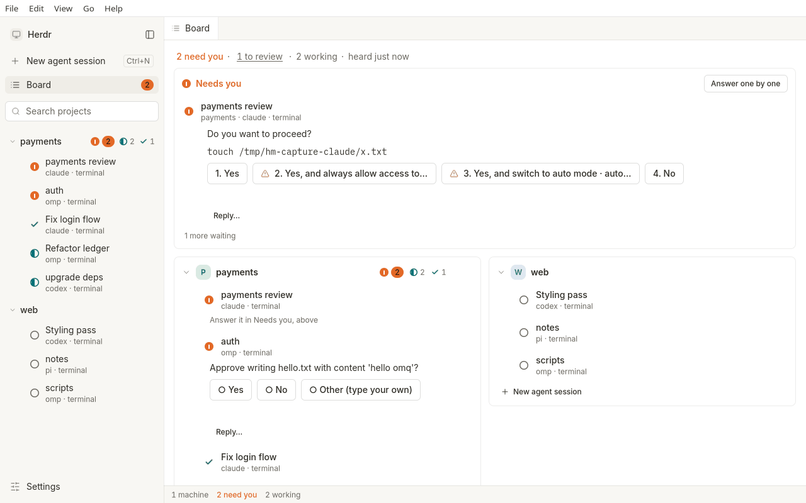
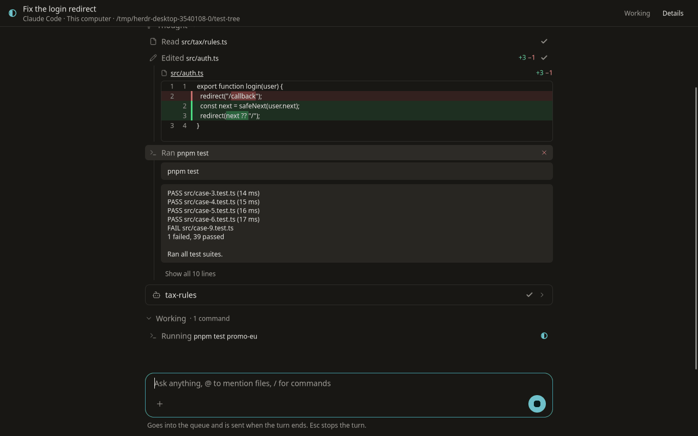
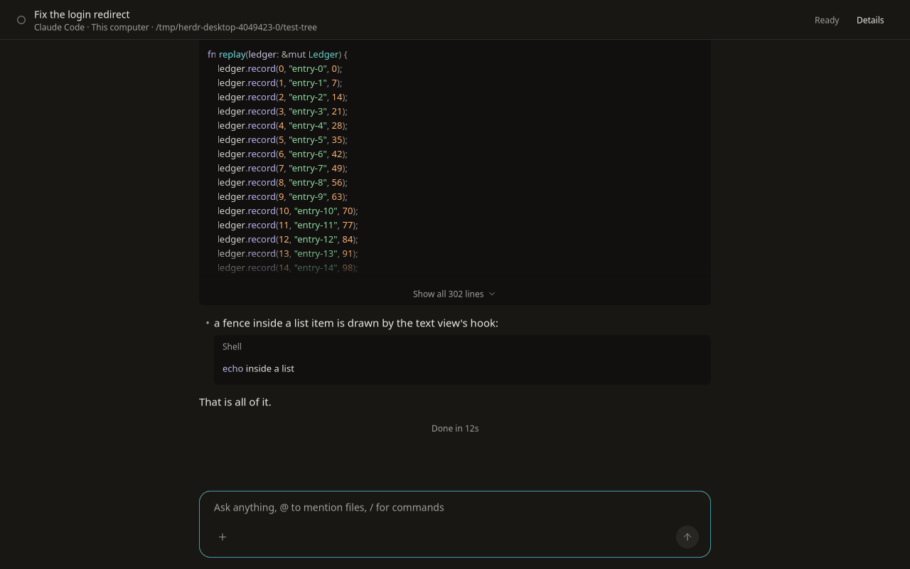

# herdr-desktop

A native desktop client for [herdr](https://herdr.dev), the terminal multiplexer for coding agents. It is the desktop counterpart of `herdr-mobile`: one window shows every agent on every machine, says the moment one needs you, lets you answer safely, and lets you look away.

Built with [nsh](https://github.com/longbridge/nsh) (Rust + TSX, native widgets: GTK 4 on Linux, AppKit on macOS; no web view for the UI). Linux first; macOS (Apple silicon) builds are new and untried on a real Mac ([docs/MACOS.md](docs/MACOS.md)). License: GPL-3.0-or-later.

## What it does

- **Board.** Agents grouped by project (a repository with its worktrees, or a folder), chat sessions and terminal agents together, each row and project header showing its state (needs you, working, to review) and an inbox of what waits for an answer over them; one count is shared by the status line, the window title and notifications.
- **Answer.** Permission prompts of terminal agents become buttons showing the exact command. Risky answers are two-step. Nothing is sent when the question changed.
- **Watch and steer.** A live read-only view of each pane, a message box, a Stop button, links; chat sessions have slash commands.
- **Many machines.** This computer plus any machine reachable with `ssh` (your `~/.ssh/config`, agent and ProxyJump are honoured; no password prompts).
- **Agent sessions.** ACP agents (for example `omp acp`) started from the app, with a chat transcript, a permission dock and replay after a restart.
- **Accessible.** Screen-reader roles and labels on every control, keyboard everywhere, contrast-tested themes, reduced motion.

Feature-by-feature status against the phone app is in [docs/PARITY.md](docs/PARITY.md).

## A look

<p>  </p>

Illustrations from scripted data, not a gallery: they date. `make shots` takes current ones into `.scratch/shots/` (not committed).

## Install

One command, Linux x86_64 or macOS Apple silicon (Intel Macs have no build: nsh 0.4.0 has no Intel runtime):

```sh
curl -fsSL https://raw.githubusercontent.com/tuan3w/herdr-desktop/main/scripts/install.sh | sh
```

It takes the newest release (pre-releases included), refuses to install when the download does not match `SHA256SUMS`, and replaces the previous install. It never uses `sudo`.

- **Linux:** installs to `~/.local/opt/herdr-desktop`, links `~/.local/bin/herdr-desktop` and adds the menu entry and icon. Needs GTK 4.14+ (`libgtk-4-1`) and WebKitGTK 6.0 (`libwebkitgtk-6.0-4`) at run time.
- **macOS:** installs `~/Applications/Herdr Desktop.app`, verifies its signature and clears the quarantine flag, so it opens first time. The app is signed with the project's own certificate, not notarized by Apple.

```sh
curl -fsSL .../scripts/install.sh | sh -s -- --version 0.1.0-alpha.2   # a specific release
curl -fsSL .../scripts/install.sh | sh -s -- --uninstall               # remove it (your data stays)
```

`PREFIX=DIR` (Linux) and `APP_DIR=DIR` (macOS) choose another place. Prefer to read it first: [scripts/install.sh](scripts/install.sh). The archives and `SHA256SUMS` are on the [Releases page](https://github.com/tuan3w/herdr-desktop/releases).

## Status

Alpha: `0.1.0-alpha.2` is the current test release ([CHANGELOG.md](CHANGELOG.md) says what works and what does not). `docs/PARITY.md` is the ledger of what is done.

## Build

Needs Linux with GTK 4.14+, `libgtk-4-dev`, `clang`, `pkg-config`, and [nsh](https://nsh.dev) 0.4.0:

```sh
NSH_VERSION=v0.4.0 sh -c "$(curl -fsSL https://nsh.dev/install.sh)"
make        # check, test, core, docs, a11y
make run    # dev window
make package            # .scratch/dist/Herdr Desktop.tar.gz
local/install.sh        # install it for your user (--uninstall removes it)
```

On a Mac (Xcode command line tools, clang) the same commands work with `make verify-mac` in place of `make` (no AT-SPI audit) and `make package` producing `Herdr Desktop.app`. Releases are cut as in [docs/RELEASING.md](docs/RELEASING.md).

[AGENTS.md](AGENTS.md) is how to work here, [DESIGN.md](DESIGN.md) the design system, [docs/ARCHITECTURE.md](docs/ARCHITECTURE.md) how the pieces fit.
