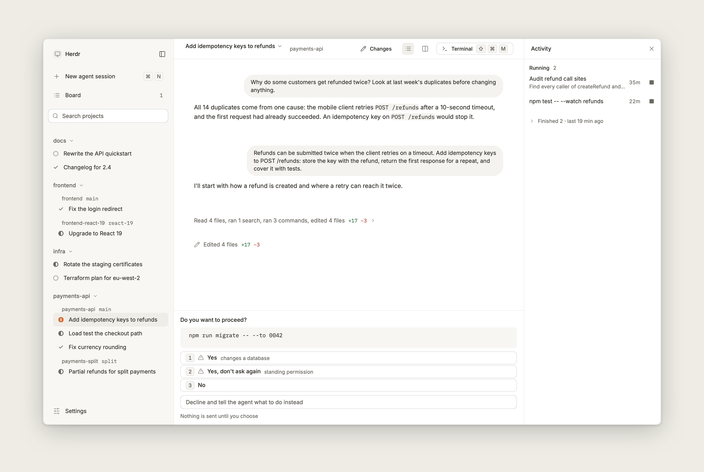
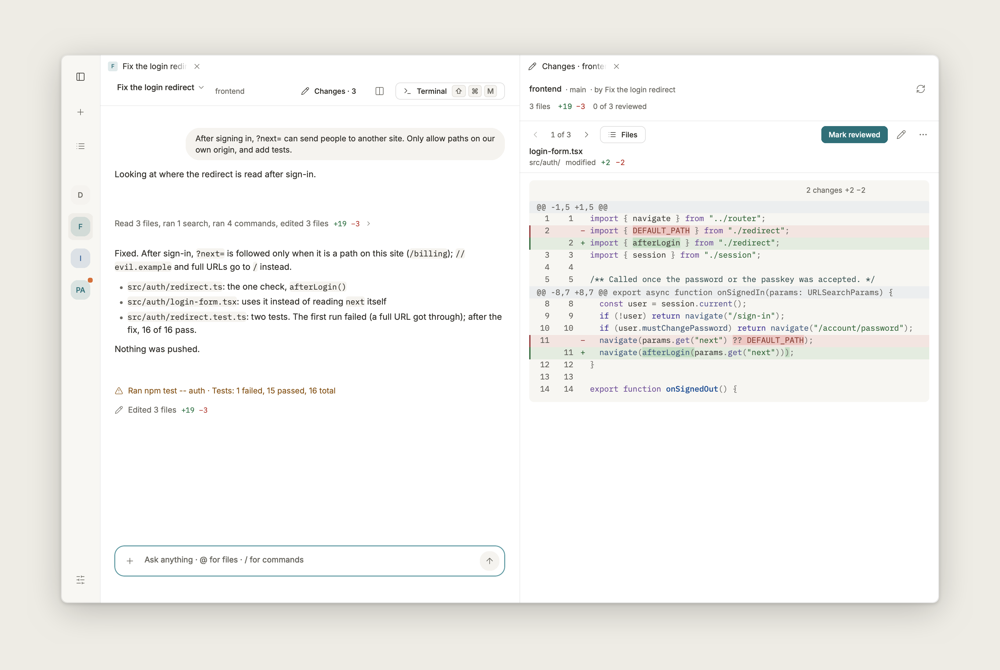
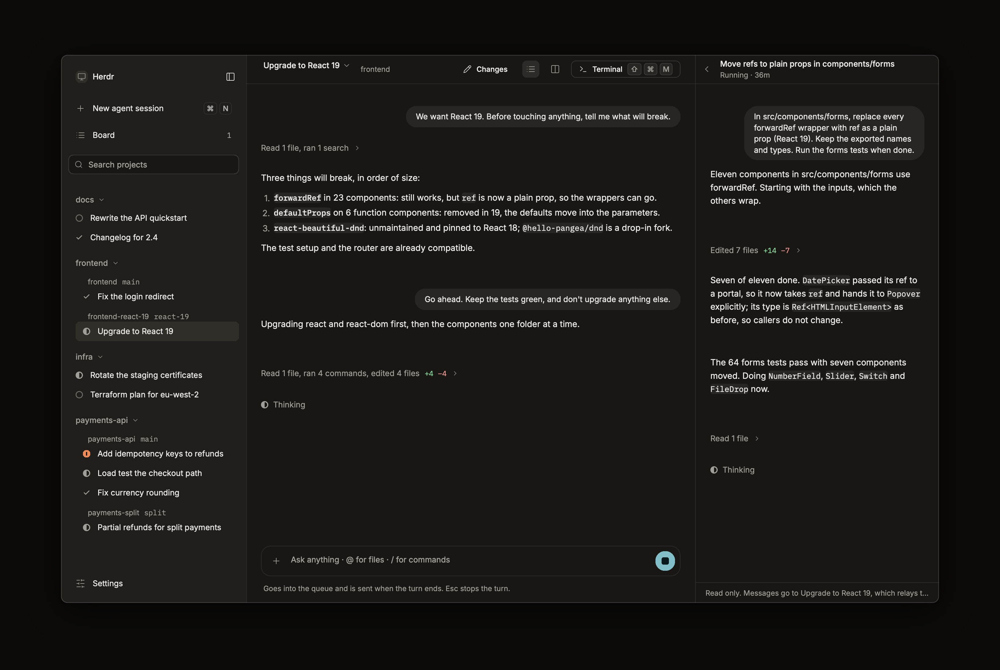

# Herdr Desktop

**The calm way to work with coding agents.** One native window for every agent on every machine: it tells you the moment one needs you, lets you answer safely, shows what it did, and lets you look away.

> Alpha software. Native (Rust and TSX on [nsh](https://github.com/longbridge/nsh), real AppKit widgets, no web view), built for macOS on Apple silicon. Expect rough edges; the [changelog](CHANGELOG.md) says what works.

<p align="center">
  
</p>
<p align="center">
  
  
</p>

## The idea

You run several agents at once (Claude Code, Codex, omp) under the [herdr](https://herdr.dev) terminal multiplexer, on this computer and on others over ssh, while you do something else. You are a **supervisor, not a pair-programmer**. Every time you glance at the window you ask the same five things, in order:

1. **Does anything need me?** Which agent, what exactly it asks, what happens if I say yes.
2. **Is everything alive and on track?** What runs, for how long, whether a machine went quiet.
3. **What did it do?** The outcome: what changed, what failed, the answer. Not the process.
4. **Steer it.** Correct, redirect, stop, start.
5. **Can I trust it?** The agent, and this app: live, stale or offline.

Herdr Desktop is built around those questions and nothing else. What needs you is the loudest thing on the screen and the only loud thing. Everything else is quiet, said once, and folded until you ask. A window you keep open all day should cost nothing when nothing happens: at rest it draws no frames.

## What it does

- **One list of every agent.** The sidebar groups agents by project (a repository with its worktrees, or a folder), across machines. A row is a state shape and a title; an agent that waits for you is marked once. `⌘J` jumps to the next one that waits.
- **Answer where the question is.** A permission prompt becomes the exact command and its choices, in the agent's own conversation. Risky answers take two presses. Nothing is ever approved by a timer, and nothing is sent if the question changed meanwhile.
- **A conversation ranked by consequence.** The chat is read from the agent's own log. Reads, searches and commands fold into one quiet line (`Read 8 files, ran 4 commands`); the final answer, failures and anything that leaves the working tree (a push, a delete, an install) stay in view.
- **Review what it changed.** `Edited 7 files` opens those seven files, not the whole folder; generated output waits folded; `Mark reviewed` moves to the next file. It stays readable in a half-window split.
- **Files, pictures and links.** Browse a machine's folders in a tab, view code and pictures, paste a screenshot into a message (scaled and compressed before it crosses the network).
- **Many machines.** This computer plus any machine your `ssh` reaches (your `~/.ssh/config`, agent and ProxyJump; no password prompts). A dropped machine says so and never pretends to be live.
- **Keyboard first and accessible.** Every action has a key, shown in its tooltip and in the palette (`⌘P`); every control is named for screen readers; themes are contrast-tested in light and dark; reduced motion is honoured.

## Install

**macOS, Apple silicon** (Intel Macs have no build: nsh 0.4.0 has no Intel runtime). One command:

```sh
curl -fsSL https://raw.githubusercontent.com/tuan3w/herdr-desktop/main/scripts/install.sh | sh
```

It takes the newest release (pre-releases included), refuses to install when the download does not match `SHA256SUMS`, replaces the previous install, verifies the signature and clears the quarantine flag, so the app opens first time (it is signed with the project's own certificate, not notarized by Apple). It installs `~/Applications/Herdr Desktop.app` and never uses `sudo`.

```sh
curl -fsSL .../scripts/install.sh | sh -s -- --version 0.1.0-alpha.3   # a specific release
curl -fsSL .../scripts/install.sh | sh -s -- --edge                    # the newest build of main (may break)
curl -fsSL .../scripts/install.sh | sh -s -- --uninstall               # remove it (your data stays)
```

`APP_DIR=DIR` chooses another place. Prefer to read it first: [scripts/install.sh](scripts/install.sh). Archives, `SHA256SUMS` and release notes are on the [Releases page](https://github.com/tuan3w/herdr-desktop/releases).

**Linux is paused.** The code still builds from source with GTK 4 (below), but no Linux package is built or tested on every change ([docs/RELEASING.md](docs/RELEASING.md), "Linux (paused)").

## Status

Alpha (`0.1.0-alpha.x`). The author uses it on macOS every day; it has not been tried widely. What works and what does not is in [CHANGELOG.md](CHANGELOG.md); what is built and still open is in [docs/STATUS.md](docs/STATUS.md).

## Build

```sh
NSH_VERSION=v0.4.0 sh -c "$(curl -fsSL https://nsh.dev/install.sh)"
make            # check, tests, core, docs (Linux; on a Mac: make verify-mac)
make run        # a dev window
make package    # .scratch/dist/Herdr Desktop.app (macOS) or a tarball (Linux)
```

The build needs zig 0.15 on the path (for the terminal emulator library) ([docs/DEVELOPMENT.md](docs/DEVELOPMENT.md)). [AGENTS.md](AGENTS.md) is how to work here, [DESIGN.md](DESIGN.md) the design system, [docs/ARCHITECTURE.md](docs/ARCHITECTURE.md) how the pieces fit. License: GPL-3.0-or-later.
