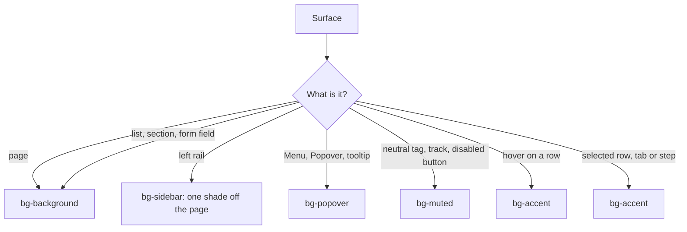

# Colors

Every color is a semantic token (`lib/theme/build.ts` makes them; see `themes.md`), used through a Tailwind-style class. The active theme and appearance decide the value: never write a `dark:` color or a theme-specific class in a screen. The one allowed `dark:` use is a tint opacity (`dark:bg-success/10`, see Status).

## Tokens

| Token | Role |
|---|---|
| `background` | page behind everything |
| `foreground` | primary text |
| `card`, `card-foreground` | the same white as the page; inputs and outline `Btn` use it so they stay opaque over a hover fill |
| `popover`, `popover-foreground` | `Menu`, `Popover` and tooltip surfaces |
| `primary`, `primary-foreground` | the one main action, checked box, progress bar. Nothing else is primary. |
| `muted`, `muted-foreground` | neutral tag fill, secondary text, disabled `Btn`, switch track |
| `accent`, `accent-foreground` | hover and selected row, tab or step: a soft grey fill |
| `border` | the hairline between sections and under headers (alpha, so it recedes on any surface) |
| `input` | form control edge |
| `ring` | keyboard focus outline |
| `success`, `warning`, `info`, `destructive` | status |
| `signal`, `signal-foreground` | "needs you": the one hot color. A count capsule, a dot on a row. Not a status. |
| `sidebar`, `sidebar-foreground`, `sidebar-accent`, `sidebar-accent-foreground`, `sidebar-primary`, `sidebar-primary-foreground`, `sidebar-border`, `sidebar-ring` | everything on the sidebar surface |
| `secondary`, `secondary-foreground` | defined, no screen uses them: use `muted` |

## One neutral

Every grey surface, border and text of a theme comes from one hue (`paper.hue` for surfaces, `ink.hue` for text and borders; in Harbor both are 90), at chroma 0.01 or less (emil-color: neutrals agree with one hue). The sidebar, the tab strip and the status bar are all `bg-sidebar`, so they are the same colour by construction; a screen that looks blue-grey next to a warm one uses a token it should not (a `term-*`, `code-*` or a hex) or is drawn in another theme. Never write a grey of your own.

## Which background

Lists are not boxed: a row is separated by whitespace and a hover fill, never by a card or a border under every row. A hairline (`border-border`) sits between major sections or under a header, nowhere else. Hover and selected share `accent`; a selected row under the pointer does not change.

## The sidebar surface

The sidebar uses only `sidebar-*` tokens (a shade off the page in light, a shade lighter in dark). Text: `text-sidebar-foreground`, secondary `text-muted-foreground`. Hover `hover:bg-sidebar-accent/60`, selected `selected:bg-sidebar-accent`. A count that needs you: `Badge tone="signal" onSidebar` (`bg-sidebar-primary`, which every theme sets to its signal). Focus: `FOCUS_RING_SIDEBAR`, an inset ring that also draws over the selected fill, so `sidebar-ring` is 3:1 on both `sidebar` and `sidebar-accent` (`theme.test.ts`; light `sidebar-ring` is L 0.58, darker than `ring`, for that reason).

## Which text color

- `text-foreground`: titles, body, values. `text-muted-foreground`: labels, meta, captions, placeholders, disabled labels.
- `text-primary-foreground`: only on a `bg-primary` fill. `text-accent-foreground`: on `bg-accent`.
- `text-success|warning|info|destructive`: status text. Plain text for a value that is late or wrong (`text-destructive` failed, `text-warning` unreachable); inside a `Pill` only for a state (an agent's); a `danger` `Btn` for stop or close.
- Alpha does not work on text colors (`text-x/60` is an unknown class): use `opacity-*` on the `Text`.

## Which border

- `border-border`: the hairline under a header or between major sections. Not under every row. `border-input`: the edge of a form control or an outline `Btn`.
- `outline-ring`: keyboard focus, always through `FOCUS_RING` (a 1.5 pt outline at offset 0, hugging the control; `FOCUS_RING_BORDERED` turns the control's own border `ring` too; `ring-*` classes draw nothing on the host) or, on stacked rows that take a fill, `FOCUS_RING_INSET` (the same line inside the edge, so no neighbor paints over it).
- Dialog, `Menu` and `Popover` popups float, so they add `shadow-md` or `shadow-lg`; nothing else has a shadow or a box. There is no card: a block is set apart by space.

## Status

| Meaning | Token | Pill tone | Example |
|---|---|---|---|
| done, healthy | `success` | `success` | an agent that is `Done` |
| unreachable, stale | `warning` | text, or `warning` | a machine that stopped answering |
| failed, destructive | `destructive` | text, or `danger` | a failed run, `Btn variant="danger"` |
| informational | `info` | `info` | an agent that is `Working` |
| nothing to flag | `muted` | plain text | Idle, counts, ages |

Status is never color alone: a `Pill` carries a word, and a state also has a shape (`docs/ACCESSIBILITY.md`). Tags are for a status property (an agent's state), not for every age or count. Tints are `/15` (`/20` warning) in light and `dark:/10` (`/12`) in dark, because bright status text on a strong tint loses contrast; `theme.test.ts` assumes exactly these.

## Icons

`Icon` is recolored from a token (`tintColor`), never a hex. `IconTone` is the closed list: `foreground` (default), `muted-foreground` (chrome: nav, `IconButton`, chevrons), `primary`, `primary-foreground`, `destructive`, `success`, `warning`, `info`, `signal`, and the sidebar tones. An icon takes the tone of the text beside it, except chrome, which is quieter than its label.

## Terminal colors

A pane draws a terminal, and a terminal's colors are the one place that is not a UI semantic token. The theme builder (`lib/theme/build.ts`, through `lib/theme/terminal.ts`) emits 18 more tokens per appearance: `term-bg`, `term-fg` and `term-0` to `term-15` (the ANSI palette, eight normal and eight bright). `term-bg` is a shade off the page. Every `term-0` to `term-15` reaches `TERM_MIN_CONTRAST` (4.5:1) on `term-bg`, and `term-fg` reaches 7:1, except the slots in `TERM_REMAPPED` (dark: 0 and 8; light: 7 and 15). Those keep their true tone because a terminal also uses them as fills; the pane component remaps text drawn in them at render time. `theme.test.ts` fails the build if a pair drops below its threshold (4.5 for text, 3 for non-text). Never use a `term-*` token outside a pane, and never a UI token for terminal output.

## Changing a color

Edit the theme spec (`lib/theme/themes.ts`), not a token value: lightness is shared on purpose. Run `nsh test` (contrast for every theme and appearance) and look at it: `nsh test` with `app.screenshot(path)` and `app.setColorScheme("dark")`.
