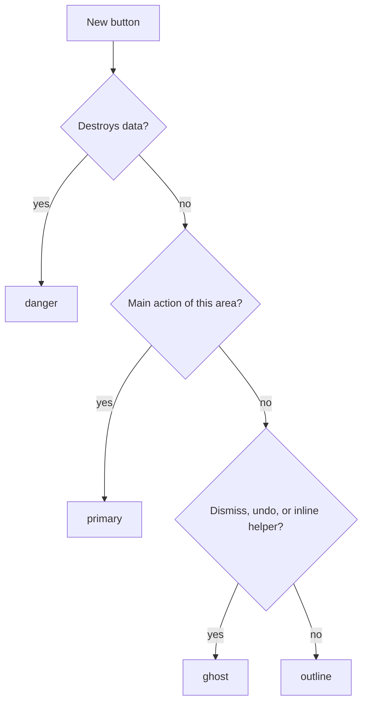

# Components

The kit lives in `components/kit/`; `./kit` re-exports it. Use it, do not rebuild it in a screen. Forms and dialogs are in `forms.md`, feedback and Settings in `patterns.md`.

## Btn

A button with a text label. Default variant `outline`.



| Variant | Use | Example |
|---|---|---|
| `primary` | the one main action of an area | `Start agent` in a new-agent dialog, `Send` in a prompt box |
| `outline` | everything else with weight, including a repeated row's main action | `Open pane`, `Reviewed` on a row |
| `ghost` | dismiss, undo, helper | `Cancel`, `Dismiss`, `Undo` |
| `danger` | destructive only | `Stop agent`, `Close session` |

- `icon` adds an `Icon` before the label. `hint` adds a keycap after it (`hint={keymap.label("mod+n")}`), hidden while disabled.
- `name` is the accessible name when the label alone repeats across rows (`Reviewed` on every agent): it must contain the label, so Voice Control's "tap Reviewed" still works.
- `loading` swaps the icon for a `Spinner`, ignores presses and appends ", busy" to the accessible name. Use it while a promise the user waited for is pending (`Open link` while `openUrl` runs). The label and the width stay.
- Size: default 32pt; `small` 28pt for dense rows only. Never below 28pt. `SelectField` and `Combobox` take the same `small`; every control in one row shares one size (`design/forms.md`).
- `small` and `still` buttons do not depress; every other `Btn` scales to 0.96 while pressed (`design/motion.md`).
- `disabled` is a muted fill with a transparent border and `text-muted-foreground`. Never fade with `opacity`.

## IconButton and Icon

`IconButton` is a 28pt button with an icon and no text: `label` is required (screen reader name and tooltip), `shortcut` appears in the tooltip, `onSidebar` recolors it for the sidebar surface, `selected` fills it while it is toggled on (the trigger of an open menu). It is always grey: a delete is not red at rest (`design/patterns.md`). `Icon` is decorative (hidden from screen readers), sizes 12, 14, 16 (default), 20, thin 1.5 strokes, color from `IconTone` (`design/colors.md`). Icons are grey chrome: they take the text color only when selected.

## Tipped and Kbd

`Tipped` wraps a control and shows `label` plus `shortcut` in a bubble after 500ms of the pointer resting (`REST_MS`; `design/overlays.md`). The `tooltip` prop on a `Button` draws nothing on the host, so tooltips live on a wrapper `View`; pass layout classes in `class` (`grow`, `items-center`). `Kbd` is a keycap with `tone` `muted` (default), `onPrimary` or `sidebar`. Tooltips are never the only place a fact lives: they cannot hold interactive content.

`Clipped` is text that is cut with an ellipsis and says so: one line by default (`lines={2}` for a preview), and when it really did cut, the pointer resting on it shows the whole text in the same bubble (`onTextLayout` reports the visible part; a fitting text has no tooltip). Pass `label` when the children are nested spans. Use it for what a row can lose (an agent name, a path, a prompt preview, every plain table cell); never for what must be read to act: a toast, an error, a dialog's content get room instead.

A long list (hundreds of rows or more: a transcript, a long board) is nsh's `List`: only the rows near the window exist and their cells are recycled, so memory and CPU follow the screen and not the data. A row is a component that reads its item as an accessor (`item()`, `id`) and keeps no state of its own, because its cell is reused for other items; give `estimatedItemSize` close to a real row. A list of tens is an `Each`. The cost is that the tree holds only the rows near the window: Tab and a screen reader walk those, and a test finds a row by its label.

## Pill and Badge

`Pill`: a status tag, not a button: a small rounded rectangle (`rounded px-1.5`) tinted by tone, for a **status property** (an agent's state). It is not for ages, counts or machine names: those are plain muted text. Tones in `design/colors.md`. The label uses `NUM`. Pill is `self-start`: inside a `flex-row items-center` wrap it in a `View` or it sticks to the top.

`Badge`: how many are waiting, on the thing that holds them. By default a plain grey number (`neutral`), because most counts are information; only a count that needs the user (`signal`, `danger`, `primary`) is a capsule, so the one thing that asks for attention is the one thing that looks like it. `dot` is "something is there" where a number does not fit (the sidebar rail, new output on a row). Hidden at 0, `99+` above `max`; `onSidebar` switches to the sidebar tokens. It is a count, never a status, and is not read on its own: the holder's `accessibilityLabel` includes the count. Used by `TabItem`, and in the app by sidebar rows, list rows (the dot) and table columns.

## PageHeader, SectionTitle

- `PageHeader`: `title` (`text-3xl font-bold`), optional `subtitle` (tabular), optional `right` (the screen's one action). Used at the top of a screen; its content column is `max-w-3xl`, centered.
- `SectionTitle`: the heading of a section of a page (`text-sm font-medium`, in the text color), optional `right` slot; `quiet` is the small grey label of a group inside a section (the groups of a list). Sentence case, never uppercase.
- Overlays are not cards: `Dialog`, `Menu` and `Popover` popups add a shadow because they float.

## Empty

Title, optional one-line hint, optional `icon` (a muted 40pt disc), children. `fill` centers it in the free space of a pane (a detail with nothing selected). Add the creating action only where the user can create the missing thing (first run); a filtered or all-clear state has a hint and no button.

## TabBar and TabItem

For views of the same record (an agent's transcript, files and details), and for the filter chips of one list (one active, each with its count, six or fewer short words). Built on `Tabs`/`Tab`. Selected is a soft `accent` fill with full-strength text; weight and width never change. `count` is a plain grey `Badge`, shown above 0; screen readers do not hear a `Badge`, so the tab's name is `label, count` (or `label, spoken`, e.g. `Needs you, 1 agent waiting`). Tabs never switch screens (that is the sidebar).

## CheckRow, Switch, Segmented

- `CheckRow`: a `Checkbox` whose label is part of the target. The tick pops in (`design/motion.md`). Other pressables (delete) go next to it, not inside. A tick is directly reversible, so it does not toast.
- `Switch`: one setting, on or off, **takes effect at once** (`Settings`: `Collapse the sidebar`). `label` is required: it is the accessible name, since the visible text lives in the `SettingRow`. If it needs a Save button, it is a checkbox in a form instead.
- `Segmented`: pick one of two to four short options that apply at once (Appearance: System, Light, Dark). Each option may carry an `icon`; `iconOnly` drops the text for a toolbar toggle between two views (list / table of one screen), the label staying as the accessible name. More options or longer labels: `SelectField`.

## SettingsSection and SettingRow

`SettingsSection` is a heading (`text-base font-medium`) over a hairline, then rows: no card, no borders between rows, the space separates them. `SettingRow` is a label, an optional `description` and a `control` on the right; `stacked` puts a wide control (the theme picker) under the text. A row with a `control` that is a button carries its own name. Add an option as a signal in `lib/settings.ts` and a `SettingRow` in its section (`design/patterns.md`).

## ActionMenu and RowMenu

`ActionMenu` is the "more" button of a record (`ellipsis` `IconButton`, popup under it, right-aligned): a detail's header. `RowMenu` wraps a list row so a right-click opens the same entries. Both take `MenuEntry[]` (`design/menus.md`): a `MenuAction` (`label`, `icon`, `shortcut`, `danger`, `disabled`, `onSelect`), a `MenuCheckbox`, a `MenuRadioGroup`, a `MenuSection`, a `MenuGroup` (`label`, `items`: a submenu) or `"separator"`.

- Build the entries once per record, in one function, and give both menus the same list, so the wording and the safeguards cannot drift apart.
- A menu is never the only route: anything used daily has a visible control (a state `SelectField` in the detail header is the same action as a menu's `Change state`).
- Destructive last, after a separator, `danger`, and through `confirmDestructive`.
- A choice among values is a `MenuRadioGroup`, which marks the current one. Items get an accessible name (`Change state: Done, selected`) so one state is not confused with the visible select of the same name; a shortcut is the item's `accessibilityHint`, and the highlighted row is `selected` for screen readers.
- The menu is ours (`menu.tsx`, on `Overlay`), not nsh's `Menu`: that one closes a submenu whenever the pointer touches another row, so the pointer could not cross to it. Here the pointer may cross the rows between a submenu's row and the submenu (`inTransit`: the triangle from where it last was to the submenu's near edge). A submenu opens after the pointer rests 100ms on its row (at once when another is open), lines its first row up with its trigger, and flips to the left at the window edge.
- Keys (a menu has one highlight, moved by pointer and keys alike; the focus stays on the trigger): Up, Down, Home, End, Page Up and Page Down move it (wrapping, skipping `disabled`); Right opens the submenu with its first row highlighted, Left or Escape closes it, a second Escape closes the menu; Return or Space chooses; letters find a row by its first letters, accents ignored; Tab closes. The first Down on a menu opened with the mouse highlights the first row. While a key has the highlight, Return on the focused trigger chooses instead of closing.
- Tests: `menu.test.ts` covers the pure rules (step, typeahead, the triangle); `components/menus.test.tsx` the keys, hover open/close, selection and the context menu. Pointer paths between rows cannot be driven headless (a hover lands on a row's middle), so the triangle is tested as geometry.

## Spinner and Skeleton

`Spinner` (`size` 12 to 20, `tone`) says "working, unknown time": inside a `Btn loading` or beside a label. `Skeleton` is a block with the real size of what will load, for the first frame of a screen (a skeleton with the shape of the screen). Do not use either for work under about 300ms, and never a full-screen spinner over data already on screen.

## Sidebar

The sidebar is the app's own component, built from kit parts; the kit holds its rules. It is the page's colour one shade darker, not a panel, and uses only `sidebar-*` tokens (`design/colors.md`). It is a tree of the board's projects: a machine (a quiet header with its needs-you count, only when there is more than one or one has a problem) holds projects, a project holds its checkouts (when it has several) and its agents in two lines (glyph, name, age; agent and chat or terminal under it). A project's header carries the state as shape and number chips (`StateChips`) and, over them on hover or focus, its menu (pin, new session here). Folds are shared with the home.

- **Width.** A resizable panel (the user drags its edge) from 1100 pt of window; narrower, the full sidebar is `SIDEBAR_WIDTH.narrow` and fixed (`snug()`); below 900 pt (`compact()`), or when the user collapsed it (`sidebarCollapsed` in `lib/settings.ts`), it is the rail (`RAIL_WIDTH`, 56pt) where the drag handle is off. One fold/unfold `IconButton` keeps its slot in the rail and is offered only when the window is wide enough to show either state.
- **The rail is one tile per project**, never one glyph per agent: a rounded square with the project's first letters on a tint from a hash of its name (`Monogram`, theme tokens, never the signal colour), a signal count in the corner when something needs you, else the quiet half ring while something works, a dot when pinned, the open project lit. A press opens a popover with the project's agents. Its name and state are the tooltip and the accessible name; many projects scroll.
- Rows are `h-7` (items `min-h-10`), icon + label, with a count at the far end. A count that needs the user is `Badge tone="signal" onSidebar`; a plain count is grey.
- Selected is a fill, never a tick or a weight. `bg-sidebar-primary` is the theme's signal color and appears only on counts that need the user.
- Focus is an inset ring (`FOCUS_RING_SIDEBAR`): the rows are 2pt apart, and an outline drawn outside a row is painted over by the fill of the row after it.
- Never hide a function in the rail: every item keeps its `accessibilityLabel` (with its count) and a tooltip with its shortcut. `IconButton onSidebar` and `Kbd tone="sidebar"` recolor for this surface.
- A row that must show `expanded`, take `onFocus`/`onBlur` (the keys bound while it has the focus) or carry `accessibilityState` is a `View role="button"` with `onPress` and the same ring and fill classes: nsh's `Button` takes none of those. The rest stay `Button`. `SearchField` hands its input ref out (`inputRef`) so `mod+0` can take the focus to it: a view cannot take the focus from code, an input can.

## Raw Button rows

A whole row that is pressable and not a tab, checkbox or `Btn` (a list row, a nav item) is a raw `Button` from `nsh/base`. It must carry:

1. ``class={`... ${FOCUS_RING}`}``: `FOCUS_RING_SIDEBAR` on the sidebar, `FOCUS_RING_INSET` on a stacked list row that takes a `selected:` fill (the outset ring of the row above a selected row loses its bottom edge)
2. `style={hoverTransition()}` so the hover and selected fill ease
3. a hover fill (`hover:bg-accent`; `hover:bg-sidebar-accent/60` in the sidebar) and, if selectable, `selected:bg-accent`: rows are `rounded-md` with a small horizontal inset, never full-bleed with a border under them
4. no font-weight or border-width change on `selected`
5. a tooltip, if its label is not visible, through `Tipped`

```tsx
// Correct
<Button onPress={() => selectedId.set(id)} selected={selectedId() === id} style={hoverTransition()}
  class={`mx-2 gap-0.5 rounded-md px-2.5 py-2 hover:bg-accent selected:bg-accent ${FOCUS_RING_INSET}`}>

// Incorrect: no ring, no easing
<Button onPress={open} class="px-4 py-3 hover:bg-accent/50">
```

## Host quirks on nsh 0.4.0

Re-checked for this kit. Headless `nsh test` has no renderer, so a fact about what is drawn cannot be re-tested here: those workarounds stay until a real GTK window shows them unneeded.

| Quirk (seen on 0.3.0, macOS) | On 0.4.0 | Kept |
|---|---|---|
| `ring-*` draws nothing; an outline is covered by a later sibling's fill; alpha on text colour is an unknown class | drawing facts, not testable headless | `FOCUS_RING*`, `opacity-*` |
| `tooltip` on `Button` draws nothing; `activeStyle` transforms are ignored | same | `Tipped`, `createMotion` |
| nsh `Menu` closes a submenu when the pointer touches another row | still in `crates/nsh-base/src/menu.rs` ("over another item, a submenu of its level closes") | the `Overlay` menu |
| JSX spread reads its object once; `uiTheme` is internal | `ThemeRoot` getter and the runtime theme switch still pass `theme.test.ts` | getter kept |
| `DataTable` needs `flex-1`; nsh 0.4.0 has a native `Select`, a native `Combobox` and `Toolbar` | the kit's are Base UI ports with their own keys and tests | not swapped |

## Adding a component

1. Does a kit component already cover it? Use it.
2. If it repeats three times, add it to `components/kit/` with a typed props object, re-export it from `index.ts`, and add its doc line here.
3. Give it every state: hover, focus (`FOCUS_RING`), pressed, disabled, and error if it takes input. Check it in all four themes and both appearances: no color is named, so it should look right by construction.
