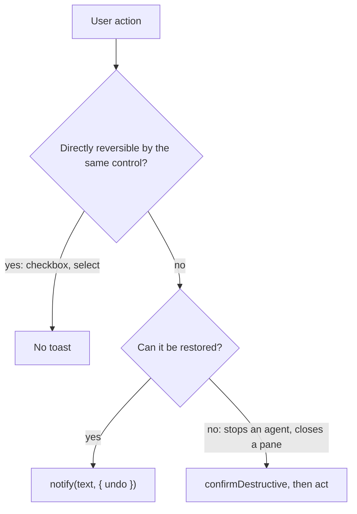

# Patterns

## Feedback and undo

Every change the user cannot see happen, and every change they might regret, gets a toast. `notify(text, { undo })` is in `components/kit/notify.tsx`; `ToastHost` is mounted once at the app root.



- A mutation that can be taken back **runs when you call it** and returns what restores it, so the call goes inside `notify`:

```tsx
// Correct: the toggle runs now; Undo toggles back
notify(`Marked “${name}” reviewed`, { undo: toggleReviewed(id) })

// Incorrect for an add: removeNote would run immediately and delete what was just saved
notify("Saved note", { undo: removeNote(saved.id) })
// Correct: wrap the inverse so it runs only on Undo
notify("Saved note", { undo: () => removeNote(saved.id) })
```

- Text is past tense and names the object: `Stopped agent api-fix`, `Marked 3 agents reviewed`, `Copied pane id p-12`. Say when something did not happen: `Reconnected to build-box, 2 panes were gone`.
- A toast with Undo stays 10s (a keyboard or screen-reader user needs time to reach it; the undo shortcut is the keyboard route), a plain confirmation 3.5s. `notify` also calls `announce`, so the message is spoken even where the toast is not a live region. The undo shortcut runs the newest undoable toast (`undoLast`, bound once at the app root; it does not fire inside a text field that uses undo). Tested: toast text, `Undo`, restore (`components/feedback.test.tsx`).
- The `Undo` button shows the undo shortcut's keycap: the shortcut is taught where it applies.

## Row actions appear on demand

A repeated row (an agent, a pane, a log line) shows nothing but its content until the pointer or the keyboard is on it. Its actions (`Reviewed`, the dismiss `IconButton`) sit in a wrapper `opacity-0 group-hover:opacity-100 group-focus-within:opacity-100` and the row carries `group`. They stay in the accessibility tree and stay pressable, so a screen reader finds them and Tab reveals them. A control the page is about (create, save, the one primary) is never hidden, and neither is a control that asks for a decision (accept or dismiss a proposal): it is not a row convenience. This is what keeps a list of 14 rows from carrying 14 buttons.

## Destructive actions

- The dismiss or close `IconButton` is grey (never `danger`-red at rest) and appears on hover; confirmation, not color, is the warning. `Btn variant="danger"` is for the one deliberate "stop this agent" button, set apart by a hairline at the end of a detail.
- Rows delete with Undo. An agent or a session that takes panes with it stops through `confirmDestructive`.
- A destructive action lives in one place per object: one module owns each action with its toast and safeguard, and the detail's `ActionMenu`, the row's `RowMenu` and the state select call it, so the wording and the safeguards cannot drift apart.

## Keyboard

Every shortcut is in `lib/shortcuts.ts`, once: the app root binds the global ones from `GLOBAL`, hints and tooltips name them through `keyLabel`, and the sheet (`Shortcuts`, opened by `⌘/` or `Ctrl+/`, `F1` too on Windows and Linux, or from Settings) lists all of them, so a change there changes the binding, the hints and the sheet together. `⌘N` and `Ctrl+N` are one shortcut: `keymap.label` writes it per platform. The sheet reads in three levels: the group's name in a quiet rail at the left, its shortcuts beside it with the keys at the right edge, a hairline between groups.

- **Platforms.** A key is a `keymap` keystroke; `mod` is Command on Apple platforms and Ctrl on every other, so one string is right on macOS, Windows and Linux. Where a platform's habit differs, that platform gets its own keys in the table (`apple`, `other`): Help is `⌘/` on a Mac and `F1` or `Ctrl+/` on Windows and Linux. The platform is read from `keymap.label` (the thing that decides what `mod` means), so a test that opens the app as Windows gets Windows' keys.
- **What a key may be.** A global shortcut always carries `mod` (or is a function key): a bare key would steal typing, and input methods type with plain letters. Never `alt`: it is Option on a Mac (`⌥P` types π) and AltGr on many Windows layouts, where Ctrl+Alt types a letter. Never a key the platform keeps (`keymap.bind` throws on `⌘Q`, `⌘H`, `⌘M`, `Ctrl+Q`, `Alt+F4`, `F11`). Punctuation keys (`,`, `/`) are matched by the US layout's physical key. Escape is never a global shortcut and never the way out of capture mode (`capture` in `GLOBAL`): agents need it.
- **In a text field** a global shortcut works unless the field uses the key itself (typing, caret, select all, cut, copy, paste, undo, redo), so the undo shortcut in a field undoes the text, not the toast. Use `{ when: "always" }` only for a key that must win there (`mod+enter` in a prompt box).
- Bind app-wide keys once at the app root (a missing handler for an entry of `GLOBAL` does not compile); bind a key that only makes sense while a component is mounted inside it (removed with the component).
- Show a key next to what it does: a `Btn hint`, a tooltip, the keycap on `Undo`. The sheet is the one place that shows them all.
- `lib/shortcuts.test.ts` checks the rules (valid keys, `mod` on globals, no `alt`, no key bound twice on a platform).
- Keyboard-initiated changes never animate (`design/motion.md`).

## Responsive

Three tiers, chosen by window width through `components/kit/responsive.ts` only. The window resizes freely and `nsh` has no minimum-size setting, so each tier is checked in a screenshot.

| Tier | Width | Layout |
|---|---|---|
| wide | 1100 and up | sidebar at the user's width; a list beside its detail |
| `compact()` | below 1100 | sidebar becomes a 56pt icon rail; lists narrow |
| `narrow()` | below 860 | one pane at a time in a two-pane screen, always as a list (the table is not offered): the list, or the detail with a back button; page padding shrinks |

- `rail()` is `compact()` or the user's `sidebarCollapsed` setting.
- The sidebar width is the user's, so the window width says little about the room a page has: a `Table` measures itself and drops its optional columns (`drop`), it does not ask `compact()`.
- A failed save (the storage has one quota for every key) never stays silent: `lib/save.ts` records it (`saveFailed`, `saveFailures`) and the app root shows a lasting toast, at most every 30 s. What is on screen is not lost, the newest preferences are not on disk.
- Never hide a function in the rail: every item keeps its `accessibilityLabel` (with its count) and a tooltip with its shortcut. A hidden panel must be reachable another way.
- Rows of labelled fields wrap their labels; align inputs with `items-end`.
- A detail header's state select and its tabs wrap or truncate rather than shrink. `Modal` is never wider than 94% of the window. Page columns are `max-w-3xl`, so a wider window adds margin, not line length.

## Settings

A settings screen is a list of rows under headings, one `SettingsSection` after another, each row a `SettingRow` (`design/components.md`). UI preferences live in `lib/settings.ts` (`themeId`, `sidebarCollapsed`, saved by `loadSettings` and an effect); domain data persists in Rust, not there.

- Every row is wired: an option that no screen reads is not added (`largeTargets`, `quickPhrases` have rows because their screens read them). Pickers whose saved value may be off the list (`paneFontSize`, `minContrast`) add the current value to their items instead of showing blank. `Settings` (`components/settings.tsx`) is a `Modal`; its Machines row opens `Machines` over it.
- Reduce motion is `reduceMotionOverride`; every motion reads `reducedMotion()` (`design/motion.md`).
- A setting applies at once and persists at once (`herdr.settings.v1`, separate from the data so clearing data keeps the theme). There is no Save button.
- Add an option: a signal in `lib/settings.ts` (with `Saved` and `loadSettings`) and a `SettingRow` in the section it belongs to. Group by what the user is thinking about, not by file.
- A choice of 2 to 4: `Segmented`. On or off: `Switch`. Many with a preview: a picker like the theme grid. A fixed list: `SelectField`.
- A screen with many settings may search them: every word of the query, in any order, against label and description, ignoring case and diacritics (`fold`). The count is announced.
- Copying to the clipboard needs `"clipboard": true` in `nsh.json` `capabilities`; without it nsh logs a warning and nothing is copied, while the toast would still claim success.

## Loading

First frames of a screen show a `Skeleton` shaped like it, not a spinner. A button waiting on the system (`Open link`) uses `Btn loading`. No screen shows a spinner for work that finishes before the eye can read it.

## Empty and first-run

First run shows an `Empty` with an icon, why, and the creating action (`Start your first agent`). Filtered or all-clear states explain (`Nothing needs you`) and do not offer a button. A pane with nothing selected uses `Empty fill`.

## Layout stability

- Numbers that change use `NUM`; counts and ages sit in their own `Text`.
- A message that can appear (`error`) reserves its line (`reserve`).
- Selected and hover states change color only.

## Accessibility

What the audit found and the rules that came out of it. Test names use `label:` (exact; a regex such as `label:/^Dismiss: /` for a family).

- **A name says which one.** A repeated button names its row and still starts with its visible word (label in name): `Btn name="Reviewed: api-fix"`, `IconButton label="Dismiss: api-fix"`, an agent row `api-fix, claude, Needs you, build-box, 4 min`. A group's name does not repeat in its members.
- **A count or a dot is hidden from screen readers (`Badge`), so its holder's name carries it**: `TabItem` (`spoken` says what it counts), a nav row, a list row.
- **Short words, not glyphs, in names**: `Moved to`, not `→`. A required field's `*` stays visible; its hint or error says so.
- **The focus stays where the user is.** A view cannot take the focus from code, so a popup never takes it: menus, `SelectField` and `Combobox` keep it on the trigger or input and move a highlight (`selected` for screen readers, `announce` for a list's count and the highlighted row). An input may be focused from code (`SearchField` after `Clear search`).
- **`announce` is for what happens away from the focus**: a field error (`Labeled` does it), a toast (`notify`), a dialog opening (`Modal`), result counts after a filter or search, a screen or record opening, an item added. Never on the first render, never for what the control's own state already says.
- **Platform limits** (nsh): no listbox, option or tabpanel roles and no heading levels; `Tabs`, `RadioGroup` and `Dialog` cannot be named; `Button` takes no hint or state beyond `selected`; focus is not returned to the opener of a popup or dialog by us. Verified headless, not with a screen reader.
- Contrast: `ring` on page, card and popover, `input` (the edge of a control) on card and page, and `muted-foreground` on popover are tested in all four themes (`lib/theme/theme.test.ts`).

## Workspace and tabs

The window is the sidebar | the tab area (`components/workspace.tsx`, nsh `DockArea`). The state and every command that changes it are in `lib/dock.ts`; the palette, the menu and the keys all call `lib/actions.ts`, so one action has one behaviour.

- **Panels.** `board` is the home tab: it cannot be closed, and `mod+1` brings it back. An agent or terminal is `pane:<machine>/<paneId>`. A tab is a view: closing it (`mod+w`) never closes the pane in herdr; closing the pane is a separate palette command behind `confirmDestructive`.
- **Opening** displays the tab if it exists, else adds it to the focused group. The focused tab is the one last opened, selected by a key, selected by a click on a tab that was not displayed, or moved: `focused` in `lib/dock.ts`. The area reports no click on a tab that is already displayed, so such a click leaves `focused` where it was; `mod+2` or a tab key moves it.
- **Splits.** `mod+\` and `mod+shift+\` move the focused tab into a new group beside its group (a tab alone in its group cannot leave it: nothing would stay behind, and the app says so). A drag has a keyboard form for each result: `Move tab to split right`, `down`, `left`, `up`, `Move tab to other group` in the palette. Dragging is the pointer's, never the only way.
- **Saved layout.** `herdr.dock.v1`, written 500 ms after the last edit (`SAVE_DELAY_MS`), read once at start (`readLayout` drops what cannot be opened and always restores the board). A tab whose pane herdr no longer has shows `Agent gone` with a `Close` button; a machine that is only offline keeps its tab with the last screen, dimmed.
- **Tab bar.** A tab shows the agent's status shape, its name and a cross. The cross is hidden from screen readers (a button inside a tab is a control inside a control): they close with `mod+w` or the palette.
- **Compact width.** Below 600 pt the area shows one group at a time with every tab in one bar; the layout is the same, only its presentation changes.

## Sidebar content

Machines first (the shape and words of each link, `Fix` for one that needs attention), a search field (`fold`: case and accents ignored, every word must match), then the board's sections as a virtualized `List` (`lib/sidebar.ts` builds the lines). `Needs you` is always open and absent when empty; the other sections fold and stay folded across runs (`herdr.sidebar.v1`). A search lists every match, also among the idle agents behind `N more idle`. `Space` on a focused row picks it for a bulk action, `Shift+Space` picks the range from the last pick, and the checkbox at the row's left does the same for the pointer. The top rows say how many need you and announce a change of that number politely.
