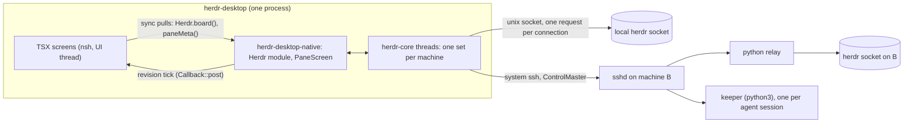

# Architecture

How herdr-desktop works, what it runs on your machines, and what it keeps on disk. Paths are relative to the repository root. Anything marked **unverified** has not been run yet.

## 1. What runs where

- **herdr.** Only its public JSON API: newline-delimited JSON on its unix socket, one request per connection; `events.subscribe` is a long-lived stream. Never its private client socket. Facts come from `docs/herdr-api.schema.json`.
- **Remote machines.** The system `ssh` binary (it honours `~/.ssh/config`, the agent, ProxyJump and Tailscale SSH), one shared connection per machine (`ControlMaster`), and a small python relay sent with the command. No in-process SSH stack, no password prompts (`BatchMode=yes`). A host key that is not trusted yet is reported with the text to run `ssh <dest>` once.
  **Verified against real ssh** on this host (`ssh localhost`, key login, the real relay, this machine's herdr 0.9.5, read-only): a second machine over ssh shows the same agents as the local one, survives its ssh children being killed by PID (the events stream and the relay) with the link's backoff and a visible `reconnecting in N s`, and an untrusted or changed host key is `Attention` with the text to act on and is not retried until `Retry` (`native/app/tests/remote.rs`, the last test of `native/core/tests/ssh.rs`; both `#[ignore]`d, run with `HERDR_DESKTOP_SSH_TEST=localhost`). A changed key was provoked with a throwaway ed25519 key in a temporary `known_hosts`, never the user's.

## 2. Threads and data flow

The UI thread belongs to the person.

1. `herdr-core` owns one `MachineLink` per machine on std threads with blocking sockets (no async runtime): a request pool, an events thread, a reconnect loop. It publishes immutable `Arc<Snapshot>` values with a monotonically increasing `revision`.
2. The native crate coalesces core updates to at most one per 16 ms and posts a revision tick to TSX. TSX never receives data in the tick: it pulls with synchronous module calls, so a burst of events costs one commit.
3. Pane screens never go through TSX: `PaneScreen` reads `Arc<Screen>` rows from core and rebinds only rows whose hash changed.
4. Domain persistence is Rust (`<dataDir>/{machines,reviewed,settings}.json`, atomic temp + rename, mode 0600). TSX keeps UI-only state; the dock layout is the one TSX value (`Storage` key `herdr.dock.v1`).
5. The notifier is one more thread (`native/app/src/notify`): the forwarder tells it "something changed", the window's state arrives from `Herdr.setBackground`, and it posts desktop notifications while the window is away (`docs/ALERTS.md`). Its rules are a pure state machine fed an `Instant`; its answers use the one checked answer path.

## 3. Decisions with their reasons

| Decision | Reason |
|---|---|
| nsh 0.4.0, GTK backend | Standalone nsh apps use GTK on Linux; GPUI is the embedding backend. |
| Own `PaneScreen`, not `Terminal` | `Terminal` and the Linux tray exist only on nsh `main`, not in 0.4.0. Swap in with a clean cutover when a release ships them. |
| Pane view is a mirror | `pane.read format=ansi` has no cursor and no mouse; input is injected keys, as on mobile. herdr cannot resize a pane over the API, so columns are herdr's. |
| One shared `target/` | The data disk is nearly full (`.cargo/config.toml`). |
| `AR=/usr/bin/ar` pinned | A foreign `ar` earlier in `PATH` breaks `cc-rs`. |
| Update check is notify-only | `nsh/updater` (signed self-update with restart) exists only on nsh `main`, from #922 on 2026-11-05, one day after v0.4.0; there is no prebuilt main CLI. Decided with the owner: keep 0.4.0, ship the release check (`lib/updates.ts`, Settings > About), and move to `nsh/updater` in a clean cutover when the next release contains it (together with `Terminal` and the tray, see above). |
| License GPL-3.0-or-later | The app links GPL-3 crates from herdr-mobile; nsh is Apache-2.0, compatible. |

## 4. Verified spikes

- **Foreign-thread wake works.** A module function that takes `cx: CallCx` and a `Callback<u32>` starts `cx.start(async { while let Ok(v) = rx.recv().await { listener.post(v) } })` over an `async_channel` receiver; a plain `std::thread` sends 1..300 at 1 kHz; draining with `try_recv` coalesces them and the TSX listener sees the last value (headless `nsh test`, nsh 0.4.0). The `set_interval` fallback is not needed. A `Callback<u32>` is `(value: number) => void` in TS: the one-object event shape applies to components, not to Rust callbacks.
- **herdr has no `pane_output_changed` event.** `events.subscribe` types use dots (`pane.updated`, `workspace.updated`, `layout.updated`, ...); `pane.agent_status_changed`, `pane.scroll_changed` and `pane.output_matched` need a `pane_id`. Live content changes arrive as global `pane_updated` events (about 25 per second across 26 panes), each carrying the pane's full info with a bumped `revision`. A watched pane is re-read when its revision changes, throttled to 20 Hz.

- **`DockArea` works headless (nsh 0.4.0).** Spike: a controlled `DockArea` renders every panel and tab, reports the whole layout with node ids after each edit, `addPanel`, `movePanel`, `splitAt`, `selectPanel` and `groupOf` act, and a press on a tab selects it; tabs are found as `role:tab`. So the workspace uses it as it is, and no tab fallback was built. Decisions that came with it: the layout is controlled (`lib/dock.ts` keeps it, so it can be saved and a panel for a vanished pane can be shown as `Agent gone`); only the center is used (no docks); the board is `closable: false`; the area has no "focused group", so `lib/dock.ts` tracks the panel last opened, selected or moved (`focused`) and the tab keys, close and split act on its group; a tab that is the only one in its group cannot split away, which the area would silently refuse, so the app says so.

## 5. Agent sessions (keeper)

Terminal agents are panes; ACP agents (omp, Claude Code, Codex, pi) are **sessions**: a `keeper` (one python3 file, herdr-mobile's, shared with the phone) owns the agent process on some machine so the agent outlives this window and the ssh connection. `native/core/src/session`:

| Part | Does |
|---|---|
| `KeeperHost` | Runs the keeper's commands on a machine: `probe`, `list`, `start`, `attach`, `kill`, `history`. Locally `python3 ~/.herdr-mobile/desktop/keeper-desktop.py` (written atomically, 0700, from the copy baked into the build). Remotely the same script, installed over the machine's ControlMaster with the script on stdin (base64 of zlib data, never on the command line) as `~/.herdr-mobile/desktop/keeper-<version>.py`, then run by a base64-wrapped `sh` script whose every argument is `shq`-quoted. Exit 65 installs and retries once; 66, 67, 69, 70, 78, 64 become typed `KeeperError`s with the phone's words. The keeper never inherits `HERDR_*` (it would report into the pane the app was launched from). |
| `SessionHandle` | One attached session: a thread that owns the `attach` child process (`python3 keeper attach ID`, deflated with `--z` over ssh) and the reducer, drains a burst of lines before publishing one immutable `SessionSnapshot` (unchanged items keep their `Arc`), and answers the person's actions only after the snapshot that shows them is published. |
| `SessionHub` | The hosts, each machine's last `list` (a poller: every 30 s in the foreground, 5 min hidden; it only lists, it never installs), the attached sessions (at most 4 per machine) and the keepers this app started. Feeds the board `SessionRow`s. |
| `adapter.rs` | The one file that uses herdr-mobile's reducer. It drives `Session`, `Transcript` and `Queue` as `herdr-tui`'s `main.rs` does (turn bookkeeping, queue rules after Stop, failure or a stop from elsewhere) and flattens the result. |

**Safety, same contract as `Herdr.answer`.** A permission or question is answered only for the request the person was shown (`requestId` and `digest` of its content), never within 400 ms of it appearing, never by a timer or default; anything else is a `Refusal` (`Changed`, `TooSoon`, ...) and nothing is sent. A form is checked on a copy before the real one is walked, so a bad field leaves it as it was. A keeper this app did not start is never killed (`SessionHub::kill` refuses, `NotOwned`); the started ones are the setting `sessions.owned`. An exited keeper's record may be dismissed: there is no process to stop.

**Why the reducer is vendored, not depended on (measured).** The plan chose a path dependency on `herdr-tui`. In a clean `herdr-core` build it works (about 10 s, +200 MB of `target/`: ratatui, crossterm, syntect with `regex-onig`, onig). It breaks the app: cargo unifies syntect's features across the build, `regex-onig` makes `onig::Region` (raw pointers) `!Send`, and nsh-base's own syntect highlighter (`nsh-base-0.4.0/src/editor/highlight.rs`, `text_view/highlight.rs`) stops compiling (`*mut i32 cannot be sent between threads safely`). So the contingency applies: `native/core/src/session/vendored/` holds the pure modules (`session`, `transcript`, `queue`, `risk`, `attach`, `question`, `diff`, `elapsed`, `width`) from herdr-mobile (`UPSTREAM` names the commit), the `acp` crate as `vendored/acp/`, `keeper.py` and `routes.json`, generated by `scripts/sync-vendored.sh` (`--check` fails when they drift from the sibling checkout; `--make-patch` rewrites the patch from the edited files). The changes to upstream are `vendored.patch`: `crate::` paths, no ratatui panel in `question.rs`, the client name, and what a desktop chat needs that upstream's parser dropped (terminal output in `_meta`, tool locations and raw output, pictures and files as `Part`s, boolean options, `modes`, usage with cost, notices, compaction, sign-in, `session/resume`); `docs/ACP.md` lists each with its test and is the candidate to upstream into herdr-mobile's `acp` crate. `acp` is vendored, not a path dependency, because those changes could not live in another repository's tree (it also dropped the `preserve_order` feature of `serde_json` that herdr-mobile's workspace sets, which `native/core/Cargo.toml` now sets). Upstream's own reducer tests run in this crate. A ratatui-free crate carved out of herdr-mobile would replace `vendored/` with a dependency, touching only `adapter.rs`.

**Not derived for sessions.** A session is never "to review": the keeper's `unseen_done` belongs to the phone (a viewer, like this app, never clears it), so showing it would leave a finished session in "to review" for good. Idle, working and needs-you map to the board's sections and counts. A lost connection ends the session in this app only (`connectionLost`); there is no automatic re-attach, the screen calls `attach` again. The reducer has no subagent rows; mobile's `subagent_*` views have no counterpart yet.

**Test seam.** Under a fixture (`HERDR_DESKTOP_TEST=1`) the local machine's keeper runs in `<dataDir>/session-home` with only `omp` on its `PATH`: a shim that runs the script named by `HERDR_DESKTOP_FAKE_AGENT`, by default this repository's `native/core/tests/support/fake_acp_agent.py` (a superset of herdr-mobile's: its header lists the prompts and the `FAKE_ACP_*` variables, every one of which reaches the agent from the test process, including `FAKE_ACP_SEED` for past sessions). A test never touches the real home or starts a real agent.

**Observed sessions (`Show chat`).** An agent in a terminal pane (omp, Claude Code, Codex) opens as the same chat a keeper session is, with nothing to set up: `native/core/src/observed`. The transcript is the agent's own session log, followed through the keeper's `follow` command over the machine's channel (`KeeperHost::follow`: a child process locally, ssh on the ControlMaster remotely, deflated with `--z`), and pictures the log does not carry come back with `blob` (`ObservedHandle::log_picture`); omp pictures are plain files in its `blobs/` folder, read through `Files`.

| Part | Does |
|---|---|
| `omp`, `claude`, `codex` (`LogMapper`) | Ports of herdr-mobile's log mappers: a line of the log becomes `Update`s (a whole message that replaces the one with its id, an ACP-JSON tool call or patch, plan, title, commands, cleared) and the mapper keeps what the log says about open tool calls, a pending question, a proposed plan, subagents and background tasks. `observed/model.rs` is the contract. |
| `locate`, `kinds` | Where the log is: herdr's `agent_session` (omp), `~/.claude/sessions/<pid>.json` (Claude Code), a thread id's file (Codex). `kind_for(agent label)` registers mapper, locator, question driver and what a kind can do. |
| `ask` (`AskDriver`) | The question tool is answered by keys, one screen at a time, from what the pane shows (omp, Claude Code); omp's approval and plan-review menus become a `PromptInfo`. The screen is the truth: a screen that is not the expected dialog is a `Mismatch` and nothing is sent. |
| `session` (`ObservedHandle`) | Two threads: a follower (locate, `follow`, retry with the phone's back-off) and a worker (map, transcript, one snapshot per burst). Typing goes to the pane's own composer (`pane.send_input`, Enter) and the log says whether it arrived; a question answer is refused unless the request id and digest are the ones shown and 400 ms have passed, then the log must record what was answered. |
| `names` | The board's name for an omp pane whose title is only the folder: the session title, else the person's last message, read from the head and tail of the log (`PaneSessionNames`, two reads at once) and handed to `Board::from` as `LogNames`. |

What an observed chat deliberately does not do: tool approvals are the terminal's own prompts (answered with `Herdr.answer` on the pane, never inside the chat), there is no message queue or settings (the agent's own composer has them), files are attached in the terminal, and subagent transcripts, earlier-history paging and "what the session made" are not ported. The transcript is the vendored reducer fed with `Update`s; two methods (`upsert_message`, `clear`) were added to it in `vendored.patch` because a log gives whole messages, not chunks. A tool call the interruption left without a result (`cancelled` in the log) shows as failed. Observed chats count against their own limit of four per machine.

## 6. Files, pages and diagrams

All of it is `herdr_core::files` (pure Rust, `cargo test` alone) behind the `Files`, `Pages` and `Diagrams` modules of the app crate (`native/app/src/files.rs`, `diagrams.rs`); TSX never sees a path it did not get from them. `design/files.md` has the screens.

| Part | Does |
|---|---|
| `Files` trait | `list`, `stat`, `read` (ranges), `put`, `commit`, `discard`, `tree`, `tree_ignored`, `local_path`. Two implementations, one set of tests for both (`tests/files.rs` and `tests/files_quick.rs` run every behaviour against both). |
| `LocalFiles` | `std::fs`. `~` is the user's home. A part file is opened with `O_NOFOLLOW`. |
| `RemoteFiles` | `fs.py` (embedded with `include_str!`) run by `SshClient::run_checked` as `python3 -c <script> <command> <args…>`: each argument is quoted by `shq` inside the generated, base64-wrapped command, and the shared `ControlMaster` carries it, so there is no second login. Errors come back as `{"error": kind}` with exit 3; no `python3` is exit 127 and says so. The tests run the real script behind a stand-in `ssh` that executes the generated command locally. |
| `Quick` (`files/quick.rs`) | Quick open (`mod+p`, `Files.search` / `Files.warm`): one in-memory index per (machine, root) of the paths `Files::tree` lists, folded once (`crate::search`), so a keystroke folds only the query; 100,000 paths answer in about 10 ms (`cargo bench --bench quick`). A walk stops at 100,000 paths, 5 s or 8 MB of path text and says `truncated`; the first ask of a root waits for it, the first ask after 60 s answers from the old index and walks again on a thread. This computer: the `ignore` crate (`.gitignore`, `.git/info/exclude`, the global ignore file; parents' ignore files are not read, because a worktree nested in an ignored folder of an outer checkout would list nothing; links are never followed out of the root), hidden files skipped except a short list (`walk.rs` `keep_name`). Another machine: `fs.py tree ROOT LIMIT` = `git ls-files --cached --others --exclude-standard` minus `--deleted`, else a walk without `.git node_modules target dist .venv __pycache__ build`; no modified times, so its empty query is in path order. Files git ignores are a second, local-only walk (rules off, 20,000 paths, same junk skipped) that the first query of 3 letters or more makes; its hits come after all others, flagged `ignored`. |
| `open` / `view_kind` | Kind by name (pictures, Markdown) then by the first 8 KB (NUL or invalid UTF-8 is binary); text is read in 2 MB steps up to `TEXT_CAP`; a remote picture is copied once to the cache, named by machine, path, size and time. |
| `upload` | Chunked into `.name.herdr-part` (each chunk must continue where the last ended), then `link` (no overwrite, atomic) or `rename` (replace). Failure, cancel and a name that appears meanwhile all remove the part file. |
| `Tunnel` | `SshClient::forward` = `ssh -O forward -L 127.0.0.1:<free>:localhost:<port>` on the shared connection (a master is started first if none runs); `Drop` and `close` cancel it. `localhost_port` accepts only `http(s)` on `localhost`, `127.0.0.1`, `[::1]`, `0.0.0.0` and refuses `user@` tricks. |
| `Diagrams.origin` | A loopback listener (`127.0.0.1`, any port) serving the bundled `assets/mermaid.min.js` at one path, started on first use. See `design/files.md` for why a listener and not `file:` or inline HTML. |

**Why not SFTP.** The machine already has a verified, authenticated connection from the relay; adding a second protocol means a second set of host-key and auth failures to classify. `python3` is already required by the relay and the keeper.

**Test seam.** `Files.testTree` (only with `HERDR_DESKTOP_TEST=1`) copies `fixtures/files/project` into `<dataDir>/test-tree`. A real remote check: `HERDR_DESKTOP_SSH_TEST=localhost cargo test --manifest-path native/core/Cargo.toml --test files -- --ignored` lists, uploads 5 MB and forwards a port over real `ssh`.

**Unverified.** `WebPage` against a real remote dev server in a GTK window (the tunnel itself is verified over real ssh to this machine, the dialog is not); the `Open in browser` button; Orca on the diagram web view.

## 7. Projects and the home (decision record)

**Decision.** The home and the sidebar group agents by **project**, not by state. State is the shape and number on every row and project header, the one shared count (`Counts`) still feeds the status line, the window title, the status bar, notifications and triage. A compact `Needs you` inbox over the projects holds the agents waiting on an answer, because attention is the product; it is not the layout.

**Why.** A person thinks "the payments API", not "workspace 3". Grouped by state, the same agent jumped between lists whenever it worked or finished, so nothing could be found by place; a desktop has the room to keep a project in one place and let its state be read in it. Chat sessions and terminal agents of one project had no common list at all.

| Part | Does |
|---|---|
| `project.rs` (`Directory`, `Project`) | One machine's map from workspaces and folders to projects, built from the snapshot: herdr's `repo_key` (shared by the main checkout and every linked worktree), else the workspace label, else the folder. A session is matched by its folder against the machine's checkouts and repository roots, the deepest wins, else its folder is its own project. A project is per machine. |
| `Board::from` | Takes the pins (`BoardExtras::pins`) and returns `projects` (pinned first, then by name, then machine and key: stable, so nothing moves under the pointer), the two inboxes `needs_you` and `to_review` (the triage and notification orders, unchanged) and the `Counts`. The state sections and `IDLE_SHOWN` are gone. |
| `Engine::pin_project` | Pins live in the settings file (`projects.pinned`, a list of project keys); toggling rebuilds the board. |
| `lib/open-agent.ts` | Which view opens an agent (chat, or its terminal mirror): see `design/board.md`. The dock holds both as `session:<machine>/<id>` and `pane:<machine>/<paneId>` panels. |

**Not available from herdr.** A checkout's **branch**: the snapshot's workspace carries `repo_key`, `repo_name`, `repo_root`, `checkout_path` and `is_linked_worktree` only; branches come from `worktree.list`. The app shows the checkout's folder name (herdr names worktree folders after their branch, but that is a habit, not a guarantee) and does not read `worktree.list` yet. A workspace with no git folder has no checkouts and is grouped by its label.

**Unverified.** The grouping against a live herdr with worktrees (the live read-only check lists `repo_key` only when herdr reports it); the project grouping of chat sessions started in a subfolder of a linked worktree was checked on fixtures only.

## 8. Open items

- **unverified:** `Command` inside the kit `Modal`, and `DockArea` in a real GTK window (tab drags, focus rings, compact width): only the headless runner has been used. Fallbacks: kit `Combobox` panel for the palette, `ResizablePanelGroup` + kit `Tabs` for the workspace.
