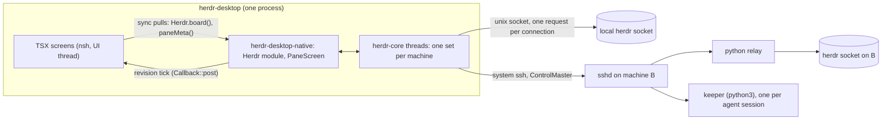

# Architecture

How herdr-desktop works, what it runs on your machines, and what it keeps on disk. Paths are relative to the repository root. Anything marked **unverified** has not been run yet.

## 1. What runs where

- **herdr.** Only its public JSON API: newline-delimited JSON on its unix socket, one request per connection; `events.subscribe` is a long-lived stream. Never its private client socket. Facts come from `docs/herdr-api.schema.json`.
- **Remote machines.** The system `ssh` binary (it honours `~/.ssh/config`, the agent, ProxyJump and Tailscale SSH), one shared connection per machine (`ControlMaster`), and a small python relay sent with the command. No in-process SSH stack, no password prompts (`BatchMode=yes`). A host key that is not trusted yet is reported with the text to run `ssh <dest>` once.

## 2. Threads and data flow

The UI thread belongs to the person.

1. `herdr-core` owns one `MachineLink` per machine on std threads with blocking sockets (no async runtime): a request pool, an events thread, a reconnect loop. It publishes immutable `Arc<Snapshot>` values with a monotonically increasing `revision`.
2. The native crate coalesces core updates to at most one per 16 ms and posts a revision tick to TSX. TSX never receives data in the tick: it pulls with synchronous module calls, so a burst of events costs one commit.
3. Pane screens never go through TSX: `PaneScreen` reads `Arc<Screen>` rows from core and rebinds only rows whose hash changed.
4. Domain persistence is Rust (`<dataDir>/{machines,reviewed,settings}.json`, atomic temp + rename, mode 0600). TSX keeps UI-only state; the dock layout is the one TSX value (`Storage` key `herdr.dock.v1`).

## 3. Decisions with their reasons

| Decision | Reason |
|---|---|
| nsh 0.4.0, GTK backend | Standalone nsh apps use GTK on Linux; GPUI is the embedding backend. |
| Own `PaneScreen`, not `Terminal` | `Terminal` and the Linux tray exist only on nsh `main`, not in 0.4.0. Swap in with a clean cutover when a release ships them. |
| Pane view is a mirror | `pane.read format=ansi` has no cursor and no mouse; input is injected keys, as on mobile. herdr cannot resize a pane over the API, so columns are herdr's. |
| One shared `target/` | The data disk is nearly full (`.cargo/config.toml`). |
| `AR=/usr/bin/ar` pinned | A foreign `ar` earlier in `PATH` breaks `cc-rs`. |
| License GPL-3.0-or-later | The app links GPL-3 crates from herdr-mobile; nsh is Apache-2.0, compatible. |

## 4. Open items

- **unverified:** an `async-channel` receiver awaited inside a `spawn` task is woken from a foreign thread. Spike first in `native/app`; fallback is `set_interval` 8 ms draining `try_recv`. The outcome is written here.
- **unverified:** `Command` inside the kit `Modal`, and `DockArea` on Linux in 0.4.0. Fallbacks: kit `Combobox` panel for the palette, `ResizablePanelGroup` + kit `Tabs` for the workspace.
