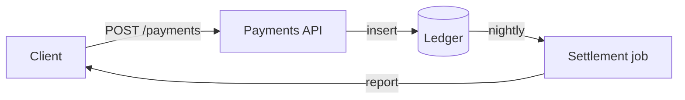

# payments-api

A small service that records payments and settles them once a day.

## Layout

| Folder | What it holds |
|---|---|
| `src/` | the ledger and the settlement job |
| `docs/` | design notes |
| `assets/` | screenshots of the dashboard |

## Run it

```sh
make dev
curl -s http://localhost:8080/health
```

## How a payment flows




- [x] ledger writes are idempotent
- [ ] settlement retries are bounded
